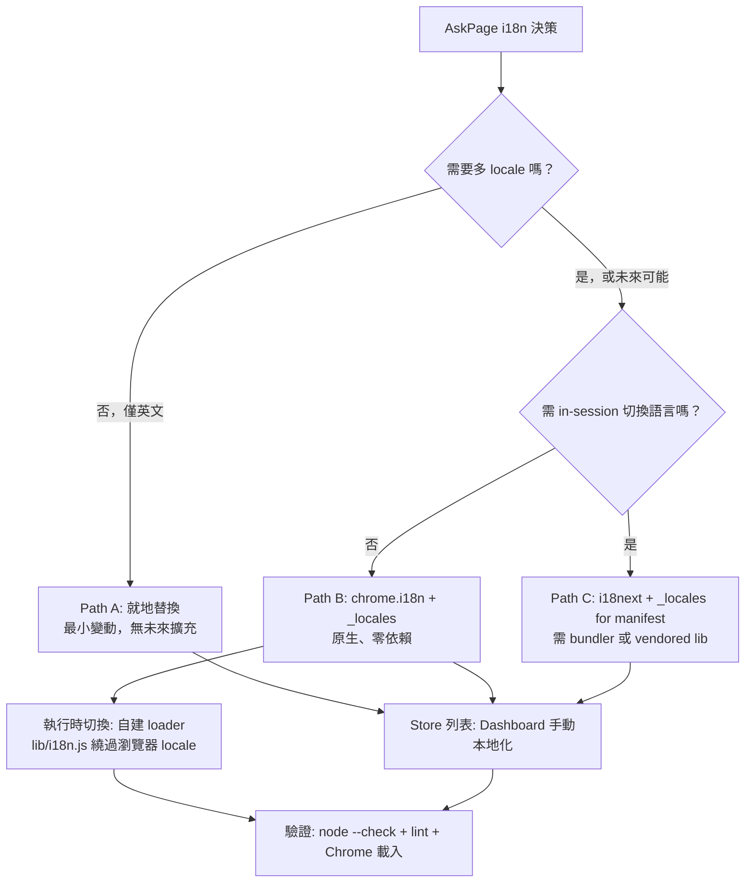

# Chrome Extension i18n Best Practice

> 版本：1.0 ｜ 研究日期：2026-07-18 ｜ 適用對象：`doggy8088/ask-page-extension`（Chrome MV3，vanilla JS，無 bundler，`minimum_chrome_version: 135`）
> 研究方式：委派 3 個 research 子代理平行調查（Chrome 官方 i18n 框架、第三方程式庫與現代實務、現有實作計畫與 repo 現狀檢視）

---

## 一、執行摘要

Chrome 官方 i18n 系統由三件套構成：`_locales/<locale>/messages.json` 檔案樹 + `manifest.json` 的 `default_locale` 欄位 + `chrome.i18n.*` API 與 `__MSG_xxx__` 替換。此系統**零依賴、原生、同步**。對 AskPage 這類 vanilla-JS、無 bundler 的 MV3 擴充功能，`chrome.i18n + _locales` 是最佳長期選擇（uBlock Origin 與 Google 官方範例皆採此路線）[^1][^4][^5]。

AskPage 已採用此框架：`_locales/en/messages.json` + `_locales/zh_TW/messages.json` 承載翻譯，JS 用 `chrome.i18n.getMessage()`，manifest/CSS 用 `__MSG_*__`，HTML 用 `data-i18n` 屬性 + bootstrap 腳本。`zh_TW` 保留繁中讓現有使用者依瀏覽器 locale 自動取得中文（fallback 鏈 `zh_TW → en`）。執行時語系切換（settings 頁）由 `lib/i18n.js` 繞過 `chrome.i18n` 的瀏覽器 locale 限制達成。

**關鍵修正**：研究初期宣稱「`chrome.i18n.getMessage` 自 Chrome 84 支援 ICU MessageFormat」——實作驗證顯示 **`getMessage` 僅做 `$name$` 替換，不解析 ICU MessageFormat 語法**（`{count, plural, ...}` 會原樣輸出為字面文字）。故計數字串使用純 `$count$` 形式，失去單複數區別（已知限制，見 TRANSLATION-LOG §5）。

---

## 二、Chrome 官方 i18n 框架（最佳實務）

### 2.1 目錄結構與 manifest 需求

```
extension-root/
├── manifest.json              # 必須宣告 "default_locale"
├── popup.html / settings.html
├── content.js / settings.js / background.js
└── _locales/
    ├── en/
    │   └── messages.json
    └── zh_TW/
        └── messages.json
```

- **locale 代碼用底線**（非連字號）：`zh_TW`、`pt_BR`、`en_GB`。用 `zh-TW` 會被靜默忽略、fallback 到 default[^1]。
- **`default_locale` 與 `_locales/` 必須同時存在或同時缺席**：有 `_locales/` 卻沒 `default_locale`，Chrome 拒絕載入；反之亦然[^1]。
- **無 `zh` 單獨碼、無 `zh_HK`**；不支援的 locale 被靜默忽略[^1]。

### 2.2 messages.json schema 與佔位符

```json
{
  "hello": {
    "message": "Hello, $USER$",
    "description": "Greet the user",
    "placeholders": {
      "user": { "content": "$1", "example": "Cira" }
    }
  },
  "bye": {
    "message": "Goodbye, $USER$. Come back to $OUR_SITE$ soon!",
    "placeholders": {
      "our_site": { "content": "Example.com" },
      "user": { "content": "$1", "example": "Cira" }
    }
  }
}
```

- 佔位符引用 `$NAME$`（大小寫不敏感）；`"content"` 內 `$1`..`$9` 對應 `getMessage(name, subs)` 第二參數位置，**最多 9 個**[^2]。
- `$$` 渲染字面 `$`；未宣告的 substitution 回傳空字串[^2]。
- 呼叫 `chrome.i18n.getMessage("bye", ["Will"])` → `"Goodbye, Will. Come back to Example.com soon!"`[^2]。

### 2.3 chrome.i18n API

| 方法 | 回傳 | 用途 |
|---|---|---|
| `getMessage(name, subs?, options?)` | `string`（缺 key 回 `''`，格式錯回 `undefined`） | 取本地化字串；最多 9 佔位符；**僅做 `$name$` 替換，不解析 ICU MessageFormat** |
| `getAcceptLanguages()` | `Promise<string[]>` | 瀏覽器 accept-languages（非 UI locale） |
| `getUILanguage()` | `string`（如 `"en-US"`，連字號） | 瀏覽器 UI 語言（執行時決策用，**非**選 messages 資料夾） |
| `detectLanguage(text)` | `Promise<{languages, isReliable}>` | CLD 語言偵測 |

`getMessage` 第三參數 `options.escapeLt: true` 可將 `<` 跳脫為 `&lt;`，便於 `innerHTML` 注入[^1]。

### 2.4 `__MSG_xxx__` 自動替換範圍（關鍵）

| 檔案類型 | `__MSG_xxx__` 自動替換？ |
|---|:---:|
| `manifest.json`（name/description/short_name/commands.*.description） | ✅ |
| `*.css`（含 `content:`、`@@extension_id`、`@@bidi_*`） | ✅ |
| `*.html` | ❌ 需 JS `getMessage()` 注入 |
| `*.js` | ❌ 需呼叫 `chrome.i18n.getMessage()` |

HTML 慣用模式：加 `data-i18n="key"` 屬性 + 啟動腳本[^4]：
```js
document.querySelectorAll('[data-i18n]').forEach(el => {
  el.textContent = chrome.i18n.getMessage(el.dataset.i18n);
});
document.querySelectorAll('[data-i18n-placeholder]').forEach(el => {
  el.placeholder = chrome.i18n.getMessage(el.dataset.i18nPlaceholder);
});
```

### 2.5 預定義訊息

| 訊息 | 說明 | manifest 可用？ |
|---|---|:---:|
| `@@extension_id` | 擴充功能 ID | ❌（僅 CSS/JS） |
| `@@ui_locale` | 當前 UI locale（如 `en_US`） | ✅（CSS） |
| `@@bidi_dir` | `ltr`/`rtl` | ✅ |
| `@@bidi_start_edge` / `@@bidi_end_edge` | `left`/`right`（依方向） | ✅ |

### 2.6 Locale fallback 鏈（設 `default_locale: "en"` + 資料夾 `en`、`zh_TW`）

| 使用者 Chrome UI locale | 結果資料夾 |
|---|---|
| `zh_TW` | `zh_TW` |
| `zh_CN` | fallback `en`（無 `zh_CN`、無 `zh`） |
| `en_US` / `en_GB` | `en`（去區域匹配） |
| `fr` | fallback `en` |

**per-message fallback 也成立**：`zh_TW/messages.json` 缺的 key 會 fallback 到 `en`。故部分翻譯安全——缺 key 顯示英文[^1]。

### 2.7 ICU MessageFormat（不支援——關鍵修正）

**重要**：實作驗證確認 `chrome.i18n.getMessage` **僅做 `$name$` 替換，不解析 ICU MessageFormat 語法**。在 messages.json 寫 `{count, plural, one {...} other {...}}` 會被原樣輸出為字面文字（含 `{count, plural, ...}` 大括號），而非依複數規則展開。

影響：計數字串（如 `agent_finished`）無法用 ICU 處理單複數。AskPage 採純 `$count$ steps` 形式，代價是 `stepCount=1` 時顯示「executed 1 steps」（文法不完美但功能正確）。

若需正確複數，選項：
1. 引入 `intl-messageformat`（FormatJS，~13KB）在 JS 端編譯 ICU 模板
2. JS 端分支：分開 `agent_finished_one`/`agent_finished_other` keys 依 count 選擇

兩者皆超出本次 i18n 框架採用範圍，記錄為已知限制（TRANSLATION-LOG §5）。

### 2.8 內容腳本（content script）限制

| 上下文 | `chrome.i18n.getMessage` 可用？ |
|---|:---:|
| Service worker（MV3 background） | ✅ 同步 |
| Popup / Options / 擴充功能頁 | ✅ 同步 |
| Content script（isolated world） | ✅ **同步**——已由 Chrome 文件與社群確認 |
| 注入頁面 main world 的 `<script>` | ❌（無 `chrome.*`） |

AskPage 的對話框由 isolated content script 建構並以 `textContent`/`innerHTML` 寫入 DOM——安全模式，`getMessage` 完全可用[^6]。

---

## 三、Chrome i18n vs 第三方程式庫決策矩陣

| 準則 | `chrome.i18n + _locales` | i18next（bundled） |
|---|---|---|
| Bundle 大小 | **0 KB**（原生） | ~13 KB gz + locale JSON |
| 複數/gender/select | ❌（getMessage 不解析 ICU；需 JS 端處理） | ✅（gender 需 ICU plugin） |
| 日期/數字格式化 | 手動 `Intl.*` | 手動 `Intl.*`（相同） |
| 巢狀 key | ❌ 扁平命名空間 | ✅ |
| 執行時切換語言 | ❌ 綁定瀏覽器 UI locale（需自建 loader 繞過） | ✅ `changeLanguage()` |
| Service worker / content script | ✅ 同步 | ✅（但 bundle 膨脹或需 message-passing） |
| manifest 整合 | ✅ `__MSG_*__` | ❌ manifest 仍需 `chrome.i18n` 或字面值 |
| 翻譯工具鏈 | 弱（扁平 JSON） | 優（Locize、Crowdin） |
| Store 列表本地化 | ❌ 獨立系統（見 §4） | ❌ 獨立系統 |
| 適配 AskPage（vanilla JS、無 bundler） | ★★★★★ | ★★★（需 bundler 或 vendored lib） |

**結論**：對無 bundler 的 vanilla-JS 擴充功能，`chrome.i18n` 已涵蓋大部分需求（佔位符、locale fallback、manifest/CSS 整合），且零 bundle 成本。i18next 僅在需要「巢狀 key」「與 web app 共用翻譯 JSON」或「不願自建 runtime loader」時才合理[^6]。

uBlock Origin（`gorhill/uBlock`）是 vanilla-JS 擴充功能採純 `chrome.i18n` 擴充至數十 locale 的教科書範例[^5]。Google 官方 `il8n` 範例展示最小模式：`default_locale` + `_locales/<lang>/messages.json` + 2 行 `popup.js`[^4]。

AskPage 為 settings 頁執行時語系切換自建 `lib/i18n.js`（fetch `_locales/<locale>/messages.json` + `window.askpageI18n.t()`），繞過 `chrome.i18n` 的瀏覽器 locale 限制——這是純 `chrome.i18n` 下達成執行時切換的務實方案，代價是 content.js/background.js 仍依瀏覽器 locale（loader 僅載入於 settings 頁）。

---

## 四、⚠️ Chrome Web Store 列表本地化（最常被誤解的一點）

**Store 列表本地化與 `_locales` 是兩個獨立系統**[^6]：

| 項目 | 在哪本地化 | 機制 |
|---|---|---|
| Store 列表（標題、說明、截圖、宣傳圖） | Developer Dashboard | "Add a new language" UI——逐語系輸入欄位 |
| 瀏覽器內擴充功能名稱（工具列、`chrome://extensions`、命令說明） | `manifest.json` | `__MSG_key__` + `_locales/<lang>/messages.json` + `default_locale` |
| 擴充功能內 UI 字串 | JS 程式碼 | `chrome.i18n.getMessage()` 或第三方程式庫 |

**關鍵事實**：
- `_locales` **不會**自動填入 Store 列表。Store 頁面顯示的內容由 Dashboard 逐語系維護。
- `default_locale + _locales` **並非** Store 列表本地化的前提——只有使用 `__MSG_*__` 於 manifest 時才需要 `_locales`。
- 但若要 manifest `name`/`description`/`commands.*.description` 在瀏覽器內隨 locale 變動，就必須用 `__MSG_*__` + `_locales`。

> 文件不穩定警示：`developer.chrome.com/docs/web-store/*` 多個 i18n 相關 URL 在 2026-07-18 回傳 404（Google 重組文件）。Dashboard 機制由活躍的 Developer Dashboard UI 與多個次要來源佐證，但無單一穩定 canonical URL 可引[^6]。

---

## 五、決策流程圖



**AskPage 採用路線**：Path B（`chrome.i18n + _locales`）+ 自建 `lib/i18n.js` loader 達成 settings 頁執行時切換。理由：
1. 零 bundle 成本（AskPage 無 bundler）[^6]
2. 原生 `chrome.i18n` 涵蓋佔位符、locale fallback、manifest/CSS 整合
3. uBlock Origin / Google 官方範例教科書路線[^4][^5]
4. 未來加 locale 為純資料檔新增（生成器 `build-locales.mjs` 維護）
5. 執行時切換需求由 `lib/i18n.js` 滿足，無需引入 i18next

---

## 六、信心評估

**高信心**（直接驗證自 Chrome 官方文件 `developer.chrome.com/docs/extensions/reference/api/i18n`、`/how-to/ui/localization-message-formats`、`/reference/manifest` 與 `GoogleChrome/chrome-extensions-samples`）：
- `_locales` 結構、`default_locale` 強制性、locale 代碼用底線、fallback 鏈三步
- messages.json schema、`$NAME$`/`$1` 佔位符、`$$` 跳脫、9 佔位符上限、缺 key 回 `''`
- `chrome.i18n` API 四方法、`getMessage` options.escapeLt
- `__MSG_*__` 自動替換僅 manifest + CSS；HTML 需 JS
- 預定義訊息 `@@extension_id`（manifest 不可用）、`@@ui_locale`/`@@bidi_*`
- content script isolated world 可同步用 `getMessage`；main world 不可
- **`getMessage` 不解析 ICU MessageFormat**——實作驗證確認（研究初期宣稱 Chrome 84+ 支援 ICU 的說法有誤或指不同 API）

**中信心**：
- Store 列表本地化經 Dashboard 且獨立於 `_locales`——由活躍 Dashboard UI 與多個次要來源佐證，但 `developer.chrome.com/docs/web-store/*` i18n URL 在 2026-07-18 多回 404（Google 重組文件），無單一穩定 canonical URL[^6]
- i18next bundle ~13KB gz、dokieli i18next-in-extension 模式——由 Bundlephobia 與 dokieli repo 確認[^6]

---

## 七、腳註

[^1]: Chrome i18n API reference — `_locales` 結構、`default_locale` 強制性、locale 代碼、fallback 鏈、預定義訊息：https://developer.chrome.com/docs/extensions/reference/api/i18n
[^2]: messages.json 格式與佔位符 — https://developer.chrome.com/docs/extensions/how-to/ui/localization-message-formats
[^4]: Google 官方 i18n 範例 — `GoogleChrome/chrome-extensions-samples:api-samples/il8n/` manifest.json（`default_locale: "en"`）、popup.js（2 行 `getMessage`）、popup.html（空元素 + JS 注入）：https://github.com/GoogleChrome/chrome-extensions-samples/tree/main/api-samples/il8n
[^5]: uBlock Origin 採純 `chrome.i18n` — `gorhill/uBlock:platform/chromium/manifest.json`（`__MSG_extShortDesc__` 等）、`_locales/<lang>/messages.json`：https://github.com/gorhill/uBlock/blob/master/platform/chromium/manifest.json
[^6]: i18n 第三方程式庫與 Store 列表本地化研究 — i18next bundle ~13KB gz（Bundlephobia https://bundlephobia.com/package/i18next）；dokieli i18next-in-extension 模式 `dokieli/src/i18n.js` https://github.com/dokieli/dokieli/blob/main/src/i18n.js ；content script isolated world `getMessage` 同步可用；Store 列表本地化經 Developer Dashboard 獨立於 `_locales`（`developer.chrome.com/docs/web-store/*` i18n URL 於 2026-07-18 多回 404，由 Dashboard UI 與次要來源佐證）